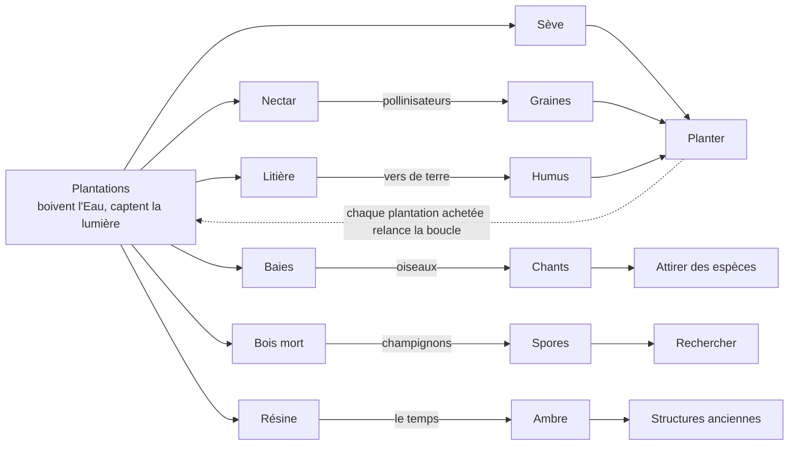

# Sylve — Document de conception

> Copie de travail du document de conception (Claude Docs), version du 25 novembre 2026.
> En cas de désaccord, la décision la plus récente l'emporte : voir aussi `docs/decisions.md`.
> Toute décision de design qui change doit être reportée ici.

## Vision et piliers

Sylve est un jeu incrémental textuel : le joueur incarne l'esprit d'une forêt, fait pousser une friche jusqu'à la forêt ancienne, puis la laisse brûler pour renaître plus forte. Le ton est contemplatif et naturaliste, avec des faits réels de biologie dans les textes.

**Fantasme du joueur** : être la forêt elle-même. Patiente, cyclique, faite de milliers d'êtres qui se nourrissent les uns les autres.

**Les cinq piliers**

1. **Chaînes vivantes.** Chaque ressource est produite par un être vivant et en nourrit un autre. Aucune ressource n'est une fin en soi.
2. **La diversité est la puissance.** L'Équilibre, un indice de biodiversité, multiplie toute la production. La monoculture rapporte vite, puis se paie en épidémies et en surpâturage.
3. **Le temps est une ressource.** Les arbres mettent des saisons, voire des années, à mûrir. L'hiver met la forêt en dormance et oblige à stocker.
4. **Les perturbations nourrissent.** Tempêtes, sécheresses et feu détruisent, mais créent du bois mort, des clairières et de la cendre. Chaque catastrophe a un revers utile.
5. **Révélation progressive.** La partie commence avec deux ressources et un bouton. Chaque ère ouvre un onglet et un nouveau système.

**Ce qu'on garde de Kittens Game, et ce qui change**

| Kittens Game                      | Sylve                                  | Ce qui change                                                        |
| --------------------------------- | -------------------------------------- | -------------------------------------------------------------------- |
| Herbe à chat, bois, minerai       | Eau, Sève, Humus, Graines              | Chaque ressource vient d'un être vivant                              |
| Chatons et métiers                | Espèces animales et niches d'habitat   | On attribue des niches à des espèces, qui mangent et se reproduisent |
| Bonheur                           | Équilibre                              | Dépend de la diversité, pas du luxe                                  |
| Bâtiments instantanés             | Plantations qui mûrissent              | Stades de croissance : semis, jeune, adulte, vieux                   |
| Science et bibliothèques          | Spores et réseau mycélien              | La recherche passe par les champignons du sol                        |
| Atelier                           | Adaptations                            | Améliorations payées en ressources variées                           |
| Saisons                           | Saisons, météo, années de glandée      | L'hiver stoppe la croissance                                         |
| Commerce avec les races           | Échanges avec les biomes voisins       | Possibles seulement au passage des migrateurs                        |
| Religion, espace, temps           | Esprit, Territoire, Mémoire des cernes | Mêmes rôles, thème forestier                                         |
| Réinitialisation (paragon, karma) | L'Incendie (Cendre, Graines dormantes) | Le prestige est un vrai phénomène écologique                         |

## Ressources et chaînes de production

Le jeu compte 15 ressources sur trois niveaux. Chaque niveau s'ouvre avec une ère, et chaque ressource a un plafond de stockage qu'il faut agrandir. Au départ, seules l'Eau et la Sève sont visibles.

| Ressource | Niveau      | Produite par                                                 | Sert à                                                                 | Plafond agrandi par                                           |
| --------- | ----------- | ------------------------------------------------------------ | ---------------------------------------------------------------------- | ------------------------------------------------------------- |
| Eau       | Brute       | Pluie, rosée sur la mousse                                   | Toutes les plantes en consomment                                       | Mousse, Mare forestière                                       |
| Sève      | Brute       | Photosynthèse des plantes (Eau × lumière de saison)          | Monnaie de base des plantations                                        | Chaque plantation adulte (+5)                                 |
| Humus     | Brute       | Vers de terre (Litière → Humus), Lichen                      | Planter les grandes essences                                           | Profondeur du sol (adaptations)                               |
| Litière   | Brute       | Feuilles mortes, herbes et fleurs fanées, surtout en automne | Nourrit vers et insectes, devient Humus                                | Tapis forestier (base 100)                                    |
| Bois mort | Brute       | Vieux arbres qui tombent, tempêtes                           | Champignons, insectes, cavités                                         | Se décompose seul : 1 % par jour                              |
| Nectar    | Transformée | Fleurs                                                       | Nourrit les pollinisateurs                                             | Prairie fleurie                                               |
| Graines   | Transformée | Fleurs pollinisées, noisetiers, arbres                       | Monnaie des plantations à partir de l'Ère II                           | Fleurs (+10), Noisetier (+50), Dispersion (×2), Souche creuse |
| Baies     | Transformée | Ronces, noisetiers, sureaux (été, automne)                   | Nourrit mésanges et renards quand leur nourriture principale manque    | Périssable : 2 % par jour                                     |
| Insectes  | Transformée | Fleurs et ronces, puis litière et bois mort                  | Nourrit les insectivores ; trop nombreux, ils deviennent des ravageurs | Fleurs (+5), Ronces (+20)                                     |
| Résine    | Transformée | Pins                                                         | Protège des parasites, devient Ambre                                   | Pin adulte                                                    |
| Spores    | Avancée     | Lichen (un peu), champignons (beaucoup)                      | Recherche (équivalent de la science)                                   | Réseau mycélien                                               |
| Chants    | Avancée     | Oiseaux                                                      | Appels pour attirer de nouvelles espèces (équivalent de la culture)    | Arbres à chanteurs                                            |
| Lueur     | Avancée     | Lucioles, champignons luminescents, vieux arbres             | Rituels de l'Esprit (équivalent de la foi)                             | Clairière sacrée                                              |
| Ambre     | Avancée     | Résine qui mûrit avec le temps                               | Structures anciennes (équivalent de l'acier)                           | Aucun                                                         |
| Cernes    | Avancée     | Arbres vénérables, un par an et par arbre                    | Couche du temps (Mémoire)                                              | Aucun                                                         |

Les conversions manuelles reprennent l'artisanat de Kittens Game. Par exemple, le joueur peut « composter » 100 Litière en 1 Humus avant que les vers de terre ne le fassent seuls.



Les plantations produisent ; le vivant transforme ; le joueur dépense surtout pour replanter. Les Insectes, nés de la litière et du bois mort, nourrissent aussi les oiseaux. La Lueur et les Cernes arrivent en fin de partie, avec les lucioles et les vieux arbres.

## Population : espèces et niches

Les animaux remplacent les chatons. Les plantations créent des niches d'habitat, et le joueur choisit quelle espèce occupe chaque niche : c'est l'équivalent de l'attribution des métiers.

**Règles**

- Chaque niche accueille une espèce compatible. Une Cavité, par exemple, peut loger une mésange, un écureuil ou une chouette.
- Réattribuer une niche prend une saison : l'espèce en place part, la nouvelle s'installe peu à peu. Ce frottement rend chaque choix important.
- La population de chaque espèce grandit vers le nombre de niches qui lui sont attribuées (croissance logistique, voir Équilibrage).
- Chaque individu mange une nourriture précise. Si elle manque, la population baisse de 2 % par jour et l'Équilibre chute.
- Les prédateurs suivent une vraie dynamique proies-prédateurs (décision du 25/11/2026).
- Les nouvelles espèces se débloquent par la recherche, puis arrivent grâce à un Appel payé en Chants.
- Au tout début, avant toute faune, le joueur clique sur « Murmurer » pour produire de la Sève à la main.

**L'Équilibre** mesure la biodiversité : c'est le nombre effectif d'espèces (plantes et animaux), calculé à partir de la part de chacune. Dix espèces à parts égales valent 10 ; une espèce écrasante fait tomber l'indice près de 1. Chaque point au-dessus de 1 donne +4 % à toute la production.

**Espèces du premier jeu (15)**

| Espèce           | Ère | Niche            | Mange             | Rôle                                                                              |
| ---------------- | --- | ---------------- | ----------------- | --------------------------------------------------------------------------------- |
| Ver de terre     | I   | Sol              | Litière           | Transforme la Litière en Humus                                                    |
| Fourmi           | II  | Sol              | Nectar            | Disperse les graines de fleurs (+2 % de Graines), aère le sol (+10 plafond d'Eau) |
| Abeille sauvage  | II  | Fleur            | Nectar            | Pollinise : multiplie la production de Graines                                    |
| Papillon         | II  | Fleur            | Nectar            | Pollinisation légère, compte double dans l'Équilibre                              |
| Mésange          | III | Fourré ou Cavité | Insectes          | Produit des Chants, limite les parasites                                          |
| Hérisson         | III | Abri au sol      | Insectes          | Limite les parasites, hiberne l'hiver                                             |
| Lapin            | III | Herbe            | Sève des herbes   | Proie ; surpâturage s'il est trop nombreux                                        |
| Renard           | III | Terrier          | Lapins            | Régule les herbivores                                                             |
| Pic épeiche      | IV  | Bois mort        | Insectes          | Crée de nouvelles Cavités, combat les scolytes                                    |
| Écureuil         | IV  | Cavité           | Graines           | Enterre des réserves : une part germe seule                                       |
| Geai des chênes  | IV  | Branche          | Graines           | Plante des chênes gratuits, ouvre l'expansion du territoire                       |
| Chevreuil        | IV  | Clairière        | Jeunes pousses    | Garde les clairières ouvertes, mais mange les semis                               |
| Luciole          | V   | Litière humide   | Rien              | Produit de la Lueur en été                                                        |
| Chouette hulotte | V   | Cavité           | Petits mammifères | Régule les rongeurs, produit Chants et Lueur                                      |
| Loup             | V   | Territoire       | Chevreuils        | Cascade trophique : gros bonus d'Équilibre                                        |

Cerf, chauve-souris et lynx sont gardés pour les versions suivantes.

## Structures : les plantations

Les bâtiments sont des plantations. Leur prix est multiplié par 1,15 à chaque exemplaire, et les arbres ne produisent qu'une fois adultes.

**Stades de croissance.** Une plantation commence en semis : il boit de l'Eau, ne produit rien et peut être mangé par les herbivores. Il devient jeune (50 % de production), puis adulte (100 %), puis vieux. Un vieux arbre produit aussi de la Litière, du Bois mort et des Cavités. Au bout de sa vie, il tombe : il laisse du Bois mort et une clairière où l'on peut replanter. La croissance s'arrête en hiver. Le rythme lent des arbres est confirmé (décision du 25/11/2026).

**Canopée.** Les couronnes des arbres couvrent le sol. La canopée est la part du terrain couverte, plafonnée à 95 %. Herbes et fleurs produisent × (1 − canopée) ; mousses et champignons × (0,3 + canopée). Fermer la forêt étouffe donc la prairie qui l'a fait naître : c'est le principal arbitrage du milieu de partie.

| Plantation       | Ère | Coût de base                | Effet (adulte)                                                                       | Temps jusqu'à l'âge adulte | Niches                      |
| ---------------- | --- | --------------------------- | ------------------------------------------------------------------------------------ | -------------------------- | --------------------------- |
| Herbes folles    | I   | 10 Sève                     | +0,2 Sève/s, boit 0,05 Eau/s                                                         | 10 jours                   | 1 Herbe                     |
| Mousse           | I   | 15 Sève                     | +50 plafond d'Eau, +0,05 Eau/s (rosée)                                               | Immédiat                   | —                           |
| Lichen           | I   | 25 Sève                     | +0,01 Humus/s, +0,012 Spores/s, +20 stockage de Spores                               | Immédiat                   | —                           |
| Trèfle           | I   | 40 Sève, 5 Humus            | +5 % de Sève pour toutes les plantes (azote)                                         | 20 jours                   | 1 Sol                       |
| Fleurs sauvages  | II  | 60 Sève, 10 Graines         | +0,1 Nectar/s, +0,02 Graines/s                                                       | 1 saison                   | 2 Fleur                     |
| Mare forestière  | II  | 100 Humus, 50 Graines       | +500 plafond d'Eau, +0,2 Eau/s (ruissellement)                                       | Immédiat                   | —                           |
| Ronces           | III | 80 Graines, 20 Humus        | +0,05 Baies/s, protègent les semis voisins                                           | 1 saison                   | 1 Fourré, 1 Abri au sol     |
| Talus            | III | 100 Humus                   | +200 plafond d'Humus                                                                 | Immédiat                   | 2 Terrier                   |
| Noisetier        | III | 150 Graines, 50 Humus       | +0,08 Baies/s, +0,03 Graines/s, +0,025 Spores/s, +40 stockage de Spores (mycorhizes) | 2 saisons                  | 2 Fourré                    |
| Bouleau          | IV  | 300 Graines, 100 Humus      | +0,3 Sève/s, Litière, couronne 1                                                     | 2 saisons                  | 1 Branche                   |
| Pin              | IV  | 400 Graines, 80 Humus       | +0,05 Résine/s, couronne 1,5, litière acide (−5 % d'Humus)                           | 3 saisons                  | 1 Branche                   |
| Champignons      | IV  | 20 Bois mort, 50 Humus      | +0,1 Spores/s, multiplié par l'ombre                                                 | Immédiat                   | —                           |
| Souche creuse    | IV  | 30 Bois mort                | +200 plafond de Graines                                                              | Immédiat                   | 1 Cavité                    |
| Tas de bois mort | IV  | 40 Bois mort                | +0,05 Insectes/s                                                                     | Immédiat                   | 1 Abri au sol, 1 Bois mort  |
| Chêne            | V   | 1 500 Graines, 400 Humus    | +1 Sève/s, beaucoup de Litière, couronne 4                                           | 3 ans                      | 2 Branche, 2 Cavité (vieux) |
| Hêtre            | V   | 1 200 Graines, 500 Humus    | Couronne 5 (ombre forte), +10 % de Spores                                            | 2 ans                      | 1 Branche                   |
| Arbre-mère       | V   | Un vieux chêne + 200 Spores | +2 % à chaque arbre relié par le mycélium, +Lueur                                    | Immédiat (prix × 1,25)     | —                           |
| Clairière sacrée | VI  | 500 Lueur, 200 Ambre        | +plafond de Lueur, ouvre les rituels avancés                                         | Immédiat                   | 1 Clairière                 |
| Vénérable        | VI  | Un chêne de 10 ans          | +1 Cerne par an, +Lueur                                                              | Immédiat                   | 3 Cavité                    |

Un jour de jeu dure 2 secondes : « 10 jours » font 20 secondes et « 3 ans » environ 40 minutes. Les chiffres sont des valeurs de départ à régler au simulateur.

**Règles précisées en v0.2 (faune et Ères II–III)**

- **Arrivées et croissance.** Une espèce débloquée vient dans les niches qu'on lui donne : chaque jour, de nouveaux individus remplissent 2 % de la place libre (1 à 3 % selon l'espèce), puis la population nourrie grandit vers ses niches (croissance logistique). Elle ne dépasse jamais ses niches.
- **Faim.** Une espèce qui manque de nourriture perd jusqu'à 2 % par jour, en proportion de ce qui manque. Mésange et Renard ont une nourriture de secours (Baies) qui couvre ce que la première ne couvre pas.
- **Niches reprises.** Les individus en trop partent à 3 % de l'excédent par jour : il faut environ une saison pour qu'une niche change vraiment d'espèce.
- **Prédation.** Chaque Renard mange 0,05 Lapin par jour, sans jamais prendre plus de 10 % des lapins par jour.
- **Hibernation.** Abeilles, papillons et hérissons dorment l'hiver : ils ne mangent pas, ne produisent pas et ne se reproduisent pas.
- **Appels.** 25 Chants font venir jusqu'à 5 individus d'un coup dans des niches libres déjà attribuées.
- **Pollinisation.** Chaque abeille nourrie ajoute +5 % aux Graines produites par les plantes, chaque papillon et chaque fourmi +2 %.
- **Équilibre.** Il compte à partir de la Chaîne alimentaire. Poids des plantes (biomasse par plante adulte) : Mousse 0,05, Lichen 0,02, Herbes et Trèfle 0,1, Fleurs 0,2, Ronces 1, Noisetier 3. Un animal compte dès qu'il y a au moins un individu ; le papillon compte double.
- **Surpâturage.** Quand les brouteurs (lapins) occupent plus de 75 % des niches d'Herbe, les semis poussent jusqu'à 2 fois moins vite ; chaque Ronce en protège 5 %.
- **Ravageurs.** Au-delà de la moitié du stockage d'Insectes, la Sève baisse, jusqu'à −20 % quand le stockage est plein. Mésanges et hérissons les tiennent en respect.
- **Saisons.** Litière ×0,5 / 0,5 / 3 / 0,5, Nectar ×1,5 / 1 / 0,25 / 0, Graines ×1 / 1 / 2 / 0, Baies ×0 / 1 / 2 / 0 (printemps, été, automne, hiver).
- **Stockage de départ** : Humus 150 (au lieu de 50), Litière, Graines, Baies, Insectes et Chants 100, Nectar 50.

**Règles précisées en v0.1**

- **Murmurer** donne +1 Sève par clic. C'est la seule source de Sève avant la première plante, donc ce qui lance la partie ; il devient vite négligeable. Piste à creuser : une capacité de l'Esprit pourrait le rendre utile plus tard.
- **Ordre d'apparition** : Herbes folles dès le départ, Mousse après 1 Herbes folles, Lichen après 2, Trèfle avec la Symbiose. Une ressource apparaît dès qu'elle existe ou qu'une plantation la produit.
- **Stockage de départ** : Eau 100, Sève 50, Humus 50, Spores 100. Chaque plantation adulte ajoute +5 de stockage de Sève.
- **Eau** : les plantes qui boivent (semis compris) ne produisent qu'au prorata de l'eau disponible quand le stock est vide. Le Lichen ne boit pas et travaille même l'hiver.
- **Saisons** : seule la Sève suit les multiplicateurs de saison en v0.1 ; les semis ne grandissent pas l'hiver.

## Le réseau mycélien : recherche et adaptations

La recherche se paie en Spores : 19 Découvertes ouvrent les ères, les espèces et les systèmes. Les Adaptations, équivalent de l'atelier, améliorent les chiffres contre des ressources variées.

Les premières Spores viennent du Lichen, qui est l'association d'un champignon et d'une algue. La recherche existe donc dès l'Ère I, lentement, puis s'accélère avec les champignons de l'Ère IV.

**Découvertes**

| Découverte         | Ère | Coût (Spores) | Prérequis                     | Débloque                                                              |
| ------------------ | --- | ------------- | ----------------------------- | --------------------------------------------------------------------- |
| Symbiose           | I   | 10            | —                             | Trèfle, Ver de terre, onglet Faune                                    |
| Enracinement       | I   | 25            | Symbiose                      | Plafond de Sève × 2                                                   |
| Floraison          | I   | 60            | Enracinement                  | **Ère II** : Fleurs sauvages, Nectar, Graines (+25 d'un coup), Fourmi |
| Pollinisation      | II  | 150           | Floraison                     | Abeille sauvage, Papillon                                             |
| Dispersion         | II  | 250           | Pollinisation                 | Mare forestière, stockage de Graines et de Spores × 2                 |
| Fructification     | II  | 400           | Dispersion                    | **Ère III** : Ronces, Noisetier, Baies                                |
| Chaîne alimentaire | III | 700           | Fructification                | Mésange, Hérisson, Lapin, Équilibre (compte à partir d'ici), Appels   |
| Prédation          | III | 1 200         | Chaîne alimentaire            | Talus, Renard                                                         |
| Lignification      | III | 2 000         | Fructification                | **Ère IV** : Bouleau, Pin, onglet Adaptations                         |
| Décomposition      | IV  | 3 500         | Lignification                 | Champignons, Bois mort, Pic épeiche                                   |
| Mycorhizes         | IV  | 6 000         | Décomposition                 | Les arbres partagent leur Sève ; Spores × 2                           |
| Migration          | IV  | 5 000         | Lignification                 | Onglet Échanges, Geai, Écureuil                                       |
| Canopée            | IV  | 9 000         | Lignification                 | **Ère V** : Chêne, Hêtre, Chevreuil                                   |
| Arbres-mères       | V   | 15 000        | Mycorhizes, Canopée           | Arbre-mère                                                            |
| Cascade trophique  | V   | 25 000        | Prédation, Canopée            | Chouette hulotte, Loup                                                |
| Bioluminescence    | V   | 30 000        | Mycorhizes                    | Luciole, Lueur, onglet Esprit                                         |
| Mémoire des cernes | V   | 60 000        | Arbres-mères                  | **Ère VI** : Cernes, Ambre, onglet Mémoire                            |
| Essaimage          | VI  | 80 000        | Migration, Mémoire des cernes | Onglet Territoire (biomes voisins)                                    |
| Pyrophytie         | VI  | 150 000       | Mémoire des cernes            | L'Incendie volontaire (prestige)                                      |

**Exemples d'Adaptations**

| Adaptation           | Coût                    | Effet                                    |
| -------------------- | ----------------------- | ---------------------------------------- |
| Racines pivotantes   | 300 Humus, 200 Sève     | +25 % de plafond d'Eau                   |
| Feuilles cireuses    | 100 Résine, 500 Graines | −30 % d'Eau bue en été                   |
| Bourgeons dormants   | 400 Graines, 50 Spores  | Production d'hiver × 2                   |
| Floraison tardive    | 300 Nectar              | Immunité au gel tardif                   |
| Écorce épaisse       | 200 Résine              | −50 % de dégâts des scolytes             |
| Glands lourds        | 2 000 Graines           | Les geais plantent deux fois plus        |
| Mycorhizes profondes | 1 000 Spores, 500 Humus | +1 % de Sève par arbre relié             |
| Chant territorial    | 500 Chants              | +25 % de Chants, Appels 20 % moins chers |

## Cycles : saisons, météo, années

Un jour dure 2 secondes, une saison 100 jours et une année 4 saisons, soit environ 13 minutes. Chaque saison change la production, et l'hiver met la forêt en dormance.

| Saison    | Sève   | Pluie       | Litière | Nectar | Particularités                                                                    |
| --------- | ------ | ----------- | ------- | ------ | --------------------------------------------------------------------------------- |
| Printemps | × 1,25 | × 1,25      | × 0,5   | × 1,5  | Naissances animales, floraison, arrivée des migrateurs                            |
| Été       | × 1,5  | × 0,6       | × 0,5   | × 1    | Croissance des arbres × 1,5, risque de sécheresse, lucioles                       |
| Automne   | × 0,75 | × 1,25      | × 3     | × 0,25 | Baies et Graines × 2, tempêtes, départ des migrateurs                             |
| Hiver     | × 0,1  | × 1 (neige) | × 0,5   | 0      | Croissance stoppée, hérissons en hibernation, les animaux vivent sur les réserves |

**Météo du jour.** Chaque jour tire une météo qui dure de 1 à 10 jours :

- **Pluie** : Eau × 2.
- **Brouillard** : Spores × 1,5.
- **Canicule** (été) : Sève × 1,2, Eau bue × 2.
- **Gel tardif** (printemps) : Nectar à 0 pendant l'épisode.
- **Orage** : Eau × 2 et risque de foudre (voir Menaces).
- **Tempête** (automne) : des vieux arbres tombent, ce qui donne Bois mort et clairières.

**Années de glandée.** Comme les vrais chênes, la forêt produit en masse tous les 2 à 5 ans, de façon synchronisée. Cette année-là, les Graines sont multipliées par 3. L'année suivante, les rongeurs explosent et les prédateurs aussi. C'est l'équivalent des cycles planétaires de Kittens Game.

**Événements à cliquer.** Des événements rares apparaissent dans le journal pendant 30 secondes : une graine portée par le vent (+Graines), un champignon rare (+Spores), un cerf blanc qui passe (+Lueur). Ils récompensent le joueur attentif sans pénaliser celui qui laisse tourner le jeu.

## Ères de succession écologique

La partie suit la succession écologique réelle : six ères, chacune ouverte par une Découverte. La première partie complète vise environ 40 heures ; les suivantes vont beaucoup plus vite grâce à la Cendre.

| Ère                  | Temps visé   | Nouveautés                                        | S'ouvre avec                                     |
| -------------------- | ------------ | ------------------------------------------------- | ------------------------------------------------ |
| I — Friche           | 0 – 15 min   | Lichen, mousse, herbes · Eau, Sève, Humus         | Début de partie · onglets Forêt, Mycélium, Faune |
| II — Prairie fleurie | 15 min – 1 h | Fleurs, abeilles, papillons · Nectar, Graines     | Floraison · Appels en Chants                     |
| III — Lande          | 1 – 3 h      | Ronces, noisetiers, mésanges, renards · Baies     | Fructification · chaîne alimentaire et Équilibre |
| IV — Forêt pionnière | 3 – 8 h      | Bouleaux, pins, champignons · Bois mort, Résine   | Lignification · onglets Adaptations, Échanges    |
| V — Forêt mature     | 8 – 20 h     | Chênes, hêtres, arbres-mères, loups · Lueur       | Canopée · onglet Esprit                          |
| VI — Forêt ancienne  | 20 – 40 h    | Vénérables · Cernes, Ambre                        | Mémoire des cernes · onglets Mémoire, Territoire |
| Incendie (prestige)  | —            | Biomasse → Cendre · diversité → Graines dormantes | La cendre nourrit la friche suivante             |

Chaque ère ajoute des espèces, des ressources et au moins un onglet. Les trois couches tardives jouent le rôle de la religion, du temps et de l'espace de Kittens Game :

| Couche     | Ressource         | Rôle                                    | Exemples                                                                                         |
| ---------- | ----------------- | --------------------------------------- | ------------------------------------------------------------------------------------------------ |
| Esprit     | Lueur             | Rituels à effet temporaire ou permanent | Appel de la pluie : 10 jours de pluie. Bénédiction des semis : croissance × 2 pendant une saison |
| Mémoire    | Cernes            | Agir sur le temps                       | Saison rêvée : simule une saison d'avance. Long été : prolonge l'été de 20 jours                 |
| Territoire | Minéraux, Graines | Coloniser les biomes voisins            | Rivière, Marais, Montagne : chacun ajoute de la surface et 3 à 4 espèces propres                 |

## Menaces et voisins

Les menaces naissent de déséquilibres que le joueur peut prévenir. Les voisins se rencontrent par les migrateurs, qui ouvrent les échanges deux fois par an.

**Menaces**

| Menace      | Déclencheur                                                  | Effet                                       | Parade                               | Revers utile                             |
| ----------- | ------------------------------------------------------------ | ------------------------------------------- | ------------------------------------ | ---------------------------------------- |
| Sécheresse  | Été et Eau sous 20 % du plafond                              | Production divisée par 2, semis qui meurent | Mousse, Mare, Feuilles cireuses      | —                                        |
| Tempête     | Automne, aléatoire                                           | Des vieux arbres tombent                    | Diversité des âges                   | Bois mort et clairières                  |
| Scolytes    | Pins au-dessus de 40 % des arbres, aggravé par la sécheresse | Épidémie : des pins meurent chaque jour     | Pic épeiche, Mésange, Écorce épaisse | Bois mort                                |
| Surpâturage | Herbivores au-delà de leurs niches                           | Semis mangés, Équilibre en baisse           | Renard, Loup, Ronces                 | —                                        |
| Gel tardif  | Printemps, aléatoire                                         | Pas de Nectar pendant l'épisode             | Floraison tardive                    | —                                        |
| Foudre      | Orage                                                        | Petit feu : quelques plantations brûlent    | Mares, zones humides                 | Un peu de Cendre pour la partie en cours |

La règle de design : une menace s'annonce toujours dans le journal un peu avant de frapper, pour laisser le temps de réagir.

**Voisins et échanges.** À partir de l'Ère IV, les migrateurs passent au printemps et à l'automne. Pendant 10 jours, le joueur peut échanger avec quatre voisins. Chaque échange fait monter la Confiance du voisin, qui améliore les taux et débloque des offres rares. Un Corridor écologique, équivalent des ambassades, garde un voisin accessible toute l'année.

| Voisin      | Espèces messagères      | Demande          | Donne                                                   |
| ----------- | ----------------------- | ---------------- | ------------------------------------------------------- |
| La Rivière  | Saumons, castors        | Bois mort        | Azote : croissance des arbres accélérée                 |
| Le Marais   | Grenouilles, hérons     | Insectes         | Limon : plafonds d'Eau et d'Humus                       |
| La Montagne | Aigles, chamois         | Graines          | Minéraux : nécessaires aux structures anciennes         |
| Le Village  | Herboriste, charbonnier | Baies, Bois mort | Nichoirs (niches en plus), protection contre les coupes |

Le Village a une particularité : si sa Confiance tombe trop bas, il coupe des arbres à la lisière. C'est la seule menace qui vient d'un voisin.

## Prestige : l'Incendie

L'Incendie remet la forêt à zéro. Il convertit la biomasse en Cendre, qui donne +1 % de production par point, et la biodiversité en Graines dormantes, qui achètent des avantages permanents.

**Quand.** Le feu volontaire est possible dès l'Ère IV, mais il ne devient rentable qu'en Ère VI. La Découverte Pyrophytie montre le gain avant de confirmer. La première fois, une courte séquence de texte raconte le feu, puis les premières pousses dans la cendre.

**Ce qui reste.** La Cendre, les Graines dormantes, les avantages achetés et le Carnet naturaliste (la collection des espèces déjà vues). Tout le reste disparaît.

La Cendre dépend de la biomasse B au moment du feu. Chaque plantation pèse un poids fixe : 0,1 pour une herbe, 10 pour un bouleau, 50 pour un chêne, 200 pour un vénérable.

```
Cendre = floor((B − 5 000) / 500)
```

Les Graines dormantes dépendent du nombre E d'espèces vivantes au moment du feu, plantes et animaux, plus les récompenses d'Épreuves R. Ce calcul pousse à brûler une forêt diverse plutôt qu'une forêt seulement grosse.

```
Graines dormantes = max(0, E − 10) + R
```

Par exemple, un premier feu en Ère VI avec B = 30 000 et 22 espèces donne 50 Cendre (+50 % de production) et 12 Graines dormantes.

**Banque de graines : avantages permanents**

| Avantage          | Coût (Graines dormantes) | Effet                                               |
| ----------------- | ------------------------ | --------------------------------------------------- |
| Sol fertile       | 1                        | La partie commence avec 50 Humus et 5 Lichens       |
| Racines profondes | 3, cumulable             | +10 % à tous les plafonds                           |
| Graines ailées    | 3                        | Les bouleaux deviennent adultes deux fois plus vite |
| Banque du sol     | 3                        | 10 % des Graines survivent au feu                   |
| Mémoire du lichen | 5                        | Les 3 premières Découvertes sont acquises d'office  |
| Pins pyrophytes   | 5                        | Après le feu, 20 % des pins repoussent en semis     |
| Chant ancestral   | 5                        | +25 % de Chants                                     |
| Esprit précoce    | 10                       | Onglet Esprit dès l'Ère III                         |
| Feux contrôlés    | 10                       | Débloque les Épreuves                               |

**Épreuves.** Ce sont des parties avec une contrainte, l'équivalent des défis de Kittens Game. On en réussit une en atteignant l'Ère V. Chacune donne une récompense permanente et 3 Graines dormantes.

| Épreuve              | Contrainte                | Récompense permanente            |
| -------------------- | ------------------------- | -------------------------------- |
| Sécheresse éternelle | Pluie divisée par 2       | +50 % d'Eau pour la Mousse       |
| Printemps silencieux | Aucun pollinisateur       | +10 % de Graines pour les fleurs |
| Sol pauvre           | Humus × 0,5               | +25 % pour les vers de terre     |
| Monoculture          | Une seule essence d'arbre | Épidémies 50 % moins fortes      |
| Sans prédateurs      | Ni Renard ni Loup         | Surpâturage 25 % moins fort      |

Une couche de prestige au-dessus de l'Incendie, par exemple une Ère glaciaire qui remettrait la Cendre à zéro, reste à décider pour plus tard.

## Équilibrage et formules

Le jeu tourne à 5 ticks par seconde. Toute production est calculée par seconde, puis multipliée par la saison, la météo, l'Équilibre et la Cendre.

**Production** d'une ressource r, où n est le nombre de plantations adultes de chaque type, p leur production de base et A la somme des bonus additifs (adaptations, découvertes) :

```
P_r = (Σ_s n_s × p_{s,r}) × (1 + A_r) × M_saison × M_météo × M_équilibre × (1 + 0,01 × Cendre)
```

**Coût** du n-ième exemplaire : facteur f = 1,15 pour les plantations, 1,12 pour les stockages, 1,25 pour les structures anciennes.

```
Coût_n = Coût_0 × f^n
```

**Équilibre.** p_i est la part de l'espèce i. Les plantes comptent par biomasse, les animaux par population, et chaque groupe pèse pour moitié. D est le nombre effectif d'espèces (indice de Shannon, sous sa forme de Hill).

```
D = exp(−Σ_i p_i × ln p_i)        M_équilibre = 1 + 0,04 × (D − 1)
```

**Canopée** c, avec S la surface du terrain (100 au départ, agrandie par le Territoire) :

```
c = min(0,95 ; Σ couronnes / S)
```

**Population.** Chaque jour, une espèce de population N grandit vers K, le nombre de niches qui lui sont attribuées, à un taux g propre à l'espèce (par exemple 0,05 pour le lapin et 0,01 pour le loup). Si la nourriture manque, elle perd 2 % par jour.

```
N ← N + g × N × (1 − N / K)
```

**Progression hors ligne.** Au retour du joueur, le jeu simule le temps écoulé par pas d'un jour (2 secondes), jusqu'à 48 heures. Le résumé s'affiche dans le journal.

**Règles de rythme**

- Premier achat en moins de 10 secondes.
- Un nouveau déblocage toutes les 2 à 5 minutes pendant la première heure, puis toutes les 15 à 30 minutes.
- Jamais plus de 10 minutes sans décision à prendre pendant les 3 premières heures.
- Les durées visées par ère figurent dans le tableau des ères.

**Outillage.** Tous les chiffres vivent dans des fichiers de données, jamais dans le code. Un simulateur sans interface joue une stratégie simple (acheter ce qui est utile et le moins cher) et mesure le temps pour atteindre chaque ère. Il tourne à chaque modification pour repérer les ruptures de rythme.

## Interface et ambiance

L'interface garde la sobriété textuelle de Kittens Game : ressources à gauche, onglets au centre, journal à droite. Seule une bande illustrée, en haut, montre la forêt qui pousse.

**Les zones de l'écran**

- **Bandeau** : date (« Printemps, jour 34, an 3 »), météo, Équilibre et canopée en %.
- **Bande illustrée** : des silhouettes en SVG apparaissent avec les plantations ; les couleurs suivent la saison.
- **Colonne des ressources** : valeur, plafond, taux par seconde et barre de remplissage. L'infobulle détaille chaque source et chaque multiplicateur, ce qui rend la profondeur lisible.
- **Onglet central** : boutons avec leur coût. Un coût qui dépasse le plafond s'affiche en rouge ; sinon, le bouton indique le temps restant avant de pouvoir payer.
- **Journal** : événements, menaces annoncées, événements à cliquer et textes d'ambiance.

**Onglets, révélés au fil de la partie**

| Onglet      | S'ouvre avec                     | Contenu                                 |
| ----------- | -------------------------------- | --------------------------------------- |
| Forêt       | Début de partie                  | Plantations, bouton Murmurer            |
| Mycélium    | Premières Spores                 | Découvertes                             |
| Faune       | Symbiose                         | Niches, espèces, Appels                 |
| Adaptations | Lignification                    | Améliorations                           |
| Échanges    | Migration                        | Voisins, Confiance, Corridors           |
| Esprit      | Bioluminescence                  | Rituels payés en Lueur                  |
| Mémoire     | Mémoire des cernes               | Couche du temps payée en Cernes         |
| Territoire  | Essaimage                        | Biomes voisins à coloniser              |
| Incendie    | Pyrophytie (aperçu dès l'Ère IV) | Gain prévu, Banque de graines, Épreuves |

**Confort.** Thème clair et sombre, raccourcis clavier, taille de texte réglable. Nombres au format 1.2k et 3.4M (1,2 k et 3,4 M en français), ou en notation scientifique au choix.

**Langues.** L'anglais d'abord, le français ensuite (décision du 25/11/2026).

**Ton des textes.** Phrases courtes, au présent, faits naturalistes vrais, pas d'humour forcé. Quelques lignes de journal pour donner le ton :

- « Une pluie fine. La mousse boit. »
- « Un geai enterre un gland à la lisière. Il l'oubliera. »
- « Les premiers coups de pic résonnent dans le bois mort. »
- « L'hiver tombe. La forêt retient son souffle. »

## Feuille de route

La première version jouable couvre l'Ère I en 15 minutes de jeu. Le prestige arrive en v0.4, et chaque version reste jouable de bout en bout.

**Choix techniques**

- TypeScript et Vite, avec un rendu DOM simple, sans framework lourd.
- Données de jeu dans des fichiers typés (ressources, plantations, découvertes, espèces), séparées du moteur.
- Boucle à pas fixe de 200 ms et un état unique, entièrement sérialisable.
- Sauvegarde automatique toutes les 30 secondes dans le navigateur, avec export et import en texte.
- Tests des formules avec Vitest et simulateur sans interface sous Node.
- Mise en ligne sur GitHub Pages.

**Versions**

1. **v0.0 — Le socle.** Outillage, moteur pur, sauvegarde versionnée, boucle temps réel, hors ligne, debug, CI. _Fait._
2. **v0.1 — Le noyau.** Ressources et plafonds, plantations à prix croissant, Murmurer, saisons, premières Découvertes. Terminée quand on joue 15 minutes jusqu'à la Floraison. _Fait : le joueur simulé l'atteint en 15 min 02._
3. **v0.2 — La prairie et la faune.** Mycélium, Fleurs et Graines, niches et espèces, nourriture, Équilibre. Ères II et III. Terminée quand on joue 3 heures sans blocage et que le simulateur tourne. _Fait : Ère II à 15 min, Ère III à 1 h 12, Ère IV à 2 h 50, jamais plus de 4 min 20 sans achat._
4. **v0.3 — La forêt.** Stades de croissance, canopée, bois mort, champignons, adaptations, météo et menaces. Ère IV.
5. **v0.4 — Le feu.** L'essentiel des Ères V et VI, Incendie, Cendre, Graines dormantes. Terminée quand une boucle complète de prestige fonctionne.
6. **v0.5 — Les couches profondes.** Échanges, Esprit, Mémoire, Territoire, Épreuves.
7. **v1.0 — La sortie.** Équilibrage complet au simulateur, bande illustrée, version française complète.

**Questions ouvertes**

- [x] Le nom « Sylve » convient-il ? Oui.
- [x] Le bouton Murmurer : +1 Sève par clic pour lancer la partie, négligeable ensuite (voir « Règles précisées en v0.1 »).
- [x] Prédation : vraie dynamique proies-prédateurs.
- [x] Langue : anglais d'abord, français ensuite.
- [ ] Faut-il une couche de prestige au-dessus de l'Incendie ? Quel en serait l'intérêt ?
- [x] Rythme lent des arbres : confirmé.
